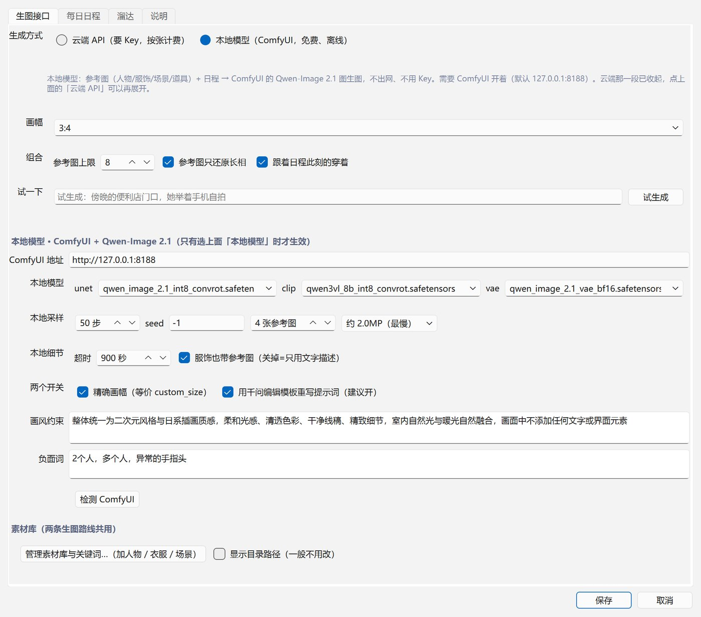
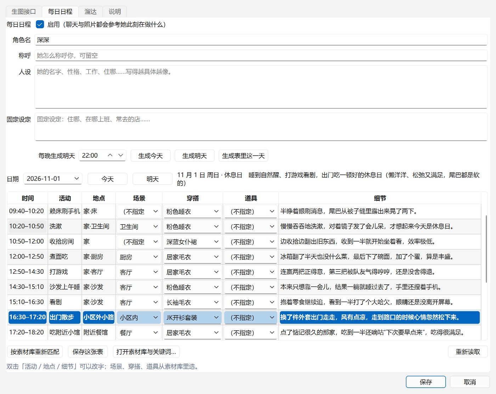

# TeaEggPet · 茶叶蛋桌宠

<p align="center">
  <a href="https://github.com/zhuliu127/TeaEggPet/releases/latest"></a>
  <a href="https://github.com/zhuliu127/TeaEggPet/releases"></a>
  <a href="LICENSE"></a>
  
  
</p>

<p align="center">
  一只住在桌面角落的蓝发小鲸鱼。<br>
  她按自己的日程过日子，按快捷键出门溜达，回来给你发一张自拍——<br>
  照片用<b>你自己的模型</b>画：云端 API 或本机 ComfyUI 都行。
</p>

---

## 她是什么

TeaEggPet 是一个 **Windows 绿色包**：解压、双击 `TeaEggPet.exe` 就跑，不用装 Python，启动不联网。

她在原项目 [dsh-pet-indesktop](https://github.com/MerZlin/dsh-pet-indesktop)（PySide6 桌宠，MIT）之上
加了一个独立包 `pet/companion/`，也就是下面的「陪伴扩展」：**过自己的日子、出门溜达、回来发照片、
会说话、记得你**。宿主本体（窗口、精灵动画、聊天、设置页）保持原样。

> 默认角色叫「茶叶蛋」。名字、人设、声音、素材库全都可以换成你自己的。

## 截图

| 设置：本地模型 / 云端模型一屏切换 | 日程 × 素材联动表 |
| --- | --- |
|  |  |

| 回来发的自拍卡 | 本地 ComfyUI 出的图 |
| --- | --- |
|  |  |

## 功能

### 陪伴扩展（本项目新增）

| 能力 | 说明 |
| --- | --- |
| **出去溜达 + 自拍** | 按全局快捷键出门，她在桌面上走动；到点或再按一次回家，按「此刻的日程」画一张自拍，弹出照片卡 |
| **每日日程** | 用你配的大模型生成她的一整天（几点做什么、在哪、穿什么、拿什么），可手改 |
| **日程 → 对话** | 聊天时把「此刻在哪、在做什么、穿了什么、接下来两段」写进 system：问「在干什么」不会再答「在桌面发呆」 |
| **生图素材库** | 人物 / 服饰 / 场景 / 道具四类参考图 + 关键词（情境·神态·动作·镜头·光线），带管理界面 |
| **日程 × 素材联动** | 日程表里「场景 / 穿搭 / 道具」直接选素材库条目；出图时按这一行挑参考图，照片卡写明用了哪些 |
| **本地 ComfyUI 通道** | Qwen-Image 2.1 图生图、多图参考；不用 Key、不出网。可扫描本地模型、一键启动 |
| **云端通道** | 65535 异步任务 / OpenAI 兼容（`/v1/images`），网关不支持某条通道时自动换一条再试 |
| **本地语音** | GPT-SoVITS v2Pro（api_v2）接管念白；固定台词合成一次进缓存，之后直接播 |
| **主动对话 + 记忆** | 她按间隔自己开口；偏好 / 事实 / 教训 / 话题四层记忆，相关时才取用 |

### 宿主本体（随 dsh-pet-indesktop 提供）

透明置顶窗口、精灵动画、桌面走动、气泡、右键菜单、AI 对话（含识屏问答、文件解读）、
歌词显示、节日提醒、待办、托盘、设置页。

## 下载

- **GitHub**：[Releases](https://github.com/zhuliu127/TeaEggPet/releases/latest) → `TeaEggPet-*-win64.zip`（约 285 MB，解压约 450 MB）
- **国内镜像**：<https://teaeggbiliai.dpdns.org/blog/> → 「软件」页里的下载按钮

解压后双击 `TeaEggPet.exe`。**必须留在这个文件夹里**，`_internal` 是它的运行库。

> 系统要求：Windows 10 / 11 64 位（ARM 未验证）。
> 未做代码签名，首次运行 Windows 会提示「未知发布者」，点「仍要运行」即可。

## 首次配置

右键桌宠 → **桌宠设置**（宿主）/ **陪伴扩展 → 陪伴扩展设置…**（扩展）。三处填完就能用：

1. **对话模型** —— 桌宠设置 → AI 对话：任意 OpenAI 兼容服务的 Base URL / API Key / 模型名。聊天、生成日程、改写提示词都用它。
2. **生图** —— 陪伴扩展设置 → 生图接口 →「生成方式」二选一：
   - **云端 API**：接口类型（65535 异步 / OpenAI 兼容）+ Base URL + Key + 模型；
   - **本地模型**：填 ComfyUI 目录 → 扫描本地模型 → 启动 ComfyUI（见下文）。

   填完点「试生成」验证。
3. **日程** —— 陪伴扩展设置 → 每日日程：填角色名与人设，点「生成今天」。

素材库可以先空着，不填就纯靠关键词出图（人物一致性会差一点）。

## 快捷键

| 动作 | 默认键 | 备注 |
| --- | --- | --- |
| 出去溜达 / 叫她回家 | `Alt+F1` | 溜达中再按一次 = 回家 |
| 立刻发一张自拍 | `Ctrl+Shift+S` | 不溜达，直接按此刻日程画 |
| 看看屏幕 | `Alt+F3` | 宿主功能，需在设置里确认 |
| AI 对话 / 截图提问 | 未绑定 | 自己绑 |

全部可在 **桌宠设置 → 互动 → 快捷键** 里改；被别的软件占用时日志会写一条。
鼠标：左键摸头、双击说话、拖拽换位置、右键菜单。

## 她的一天

### 1. 生成日程

「生成今天」会把她的一天切成若干段：`时间 / 活动 / 地点 / 场景 / 穿搭 / 道具 / 细节`。
生成时会把四个素材库塞进提示词，所以她写的衣服和常去的地方都是**你库里有的**。
生成失败会退回模板，手改也随时生效。

### 2. 日程 × 素材联动

表里「场景 / 穿搭 / 道具」是下拉框，选项就是素材库条目；改了场景而穿搭空着，会自动套该场景的默认服饰。
点「按素材库重新匹配」可把模型没写全的段补齐。

### 3. 日程 → 对话（1.4.5）

聊天时注入一段事实：

```
【你今天的生活】现在是 15:20（2026-11-06，上班日）。今天的主题：赶新需求。
此刻（09:00–18:00）你在公司：赶新需求加班——第三版方案又被推翻，晚饭点了外卖。
身上穿的：米色针织衫，外套搭在椅背上。
接下来：18:00–19:30 收尾交接；19:30–20:10 通勤回家。
```

- 完整聊天窗、快速对话、灵动岛对话都生效
- **没生成日程 / 读失败 → 不注入**，提示词与接钩子之前逐字节一致
- 场景扮演不注入（那是另一段人生）；文件解读不注入（要聚焦正文）

### 4. 出门溜达

按 `Alt+F1`：气泡「我出门啦～大概 N 分钟后回来」+ 系统通知 → 在桌面走动 → 每隔几分钟报一句此刻的见闻
（气泡 + 通知）→ 到点或再按一次回家 → 按「此刻在哪、穿什么、什么心情」画一张自拍 → 弹照片卡。

## 生图：云端 / 本地

| | 云端 API | 本地 ComfyUI |
| --- | --- | --- |
| 需要 | Base URL + Key + 模型名 | 本机装好 ComfyUI + Qwen-Image 2.1 图生图工作流 |
| 联网 | 要 | 不要 |
| 参考图 | `/v1/images/edits`；网关不支持时退回纯文字 | 多图参考，人物一致性更好 |

本地通道在生图前会用你配的模型把场景改写成 `<image1>…` 打头的编辑指令，并强制带上画风约束。

## 声音

- **本地**：GPT-SoVITS v2Pro 的 `api_v2`（默认 `http://127.0.0.1:9880`），填参考音频 / 参考文本 / 语速即可。
- **在线**：`edge-tts`（内置，无需 Key）。
- **缓存**：固定台词（点击回应、溜达播报等）合成一次就存 `companion/tts_cache/`，实测 2.6s → 16ms。
- 不想要声音：设置里关掉即可，纯气泡。

## 素材库与关键词

右键 → 陪伴扩展 → **素材库与关键词…**，五个页签：

- **人物 / 服饰 / 场景 / 道具**：新建条目 → 填名字、外观描述 → 「添加图片…」放参考图。
  人物还能填神态特点、人设、默认服饰、情境穿搭（工作学习=通勤套装 这种）。
- **关键词**：情境 / 神态 / 动作 / 镜头 / 光线五组，表格直接改，可单组恢复默认。

目录结构与 [dsh-image-studio](https://github.com/aa1355721445-lgtm/dsh-image-studio) 一致，
可以「换目录」指向你原来的库，或「从 dsh-image-studio 导入…」整库复制过来。
删除只是挪进库里的 `.trash`，不硬删。

## 从源码运行

```bash
git clone https://github.com/zhuliu127/TeaEggPet.git
cd TeaEggPet
python -m venv .venv
.venv\Scripts\activate          # PowerShell: .venv\Scripts\Activate.ps1
pip install -r requirements.txt
python -m pet                    # 或双击 run.bat（用 pythonw，无控制台）
```

Python 3.13（`pyproject.toml` 的 ruff 目标版本同步为 py313）。

## 数据与隐私

所有数据都在本机：

```
%APPDATA%\dsh-pet-standalone\
  config.json              设置
  companion\
    schedule\days\         每天的日程
    outputs\               自拍与生成的图
    image-library\         四个素材库
    presets.json           关键词
    tts_cache\             已合成的台词
  logs\                    运行日志
```

- 不上传任何数据；对话/生图只发给**你自己配的**接口。
- 云端生图会把提示词和参考图发给对方，本地 ComfyUI 通道则完全不出网。
- API Key 走 Windows 凭据管理器（keyring），不写明文到配置文件。

## 目录结构（新增部分）

```
pet/companion/
  runtime.py        # 挂载点：把下面这些东西接进宿主（热键、菜单、日程钩子、语音预热）
  walk.py           # 出去溜达 / 回家 / 途中汇报
  selfie.py         # 自拍：按日程挑场景与穿搭，组合提示词
  schedule.py       # 每日日程：生成、存储、当前时段、chat_context
  schedule_table.py # 日程 × 素材联动表
  library.py        # 素材库扫描与写入
  library_dialog.py # 素材库与关键词管理界面
  presets.py        # 关键词分组
  compose.py        # 提示词组装
  imagegen.py       # 云端生图（65535 / OpenAI 兼容，通道自动回退）
  comfy.py          # 本地 ComfyUI 通道
  qwen_prompt.py    # 千问编辑模板改写
  tts.py            # 本地 GPT-SoVITS + 合成缓存
  proactive_chat.py # 主动对话
  store.py          # companion 配置读写
  menu.py           # 右键菜单项
  settings_dialog.py# 陪伴扩展设置页
```

## 常见问题

**双击没反应 / 一闪就退**
看 `%APPDATA%\dsh-pet-standalone\logs\` 里最新的 `pet-*.log`。多半是解压不完整（要整个文件夹）或被安全软件拦了。

**生图报 403「this group is not served by this gateway」**
65535 的 Key 有分组，同一把 Key 可能只有 OpenAI 兼容那条能用。新版会自动换通道并在成功后记住配置。

**提示「语音组件缺失」**
用的是旧包或解压不全。新版内置了 `edge-tts`；语音开关在 **桌宠设置 → 语音**。

**问她「在干什么」，她答的和日程无关**
检查：① 今天的日程生成了吗（陪伴扩展设置 → 每日日程）；② 是不是开着场景扮演（扮演时不注入日程）。

**快捷键按了没反应**
被别的软件抢了。换一个组合；日志里会写「全局快捷键已生效：…」或注册失败原因。

## 更新日志

| 版本 | 主要变化 |
| --- | --- |
| **1.4.5** | AI 对话接上每日日程（问「在干什么」按当天那段回答）；文件解读、扮演场景不注入 |
| 1.4.4 | 本地 GPT-SoVITS 接管五处念白；固定台词合成缓存（2.6s → 16ms）；修复「试听一句」无声 |
| 1.4.3 | 引入产品版本号，更新检测跟 TeaEggPet 自己的版本走 |
| 1.4.2 | 修复溜达「每 N 分钟报一句」只报一次 |
| 1.0 | 首个公开版：溜达 + 自拍、每日日程、生图素材库、本地 ComfyUI |

## 致谢与许可

- 宿主内核：[dsh-pet-indesktop](https://github.com/MerZlin/dsh-pet-indesktop) © Merzlin，MIT
- 素材库与关键词体系参考：[dsh-image-studio](https://github.com/aa1355721445-lgtm/dsh-image-studio)
- 本项目：MIT，见 [LICENSE](LICENSE)；第三方组件与许可全文见 [THIRD_PARTY_NOTICES.md](THIRD_PARTY_NOTICES.md)

角色立绘、语音模型等素材请勿单独转售或用于训练。
